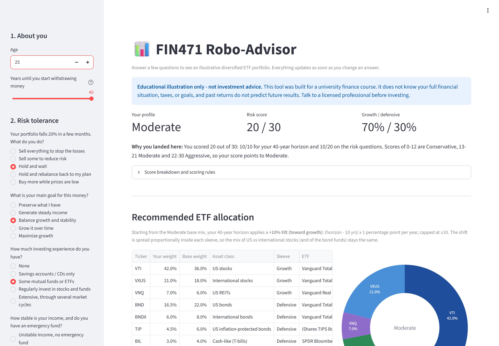
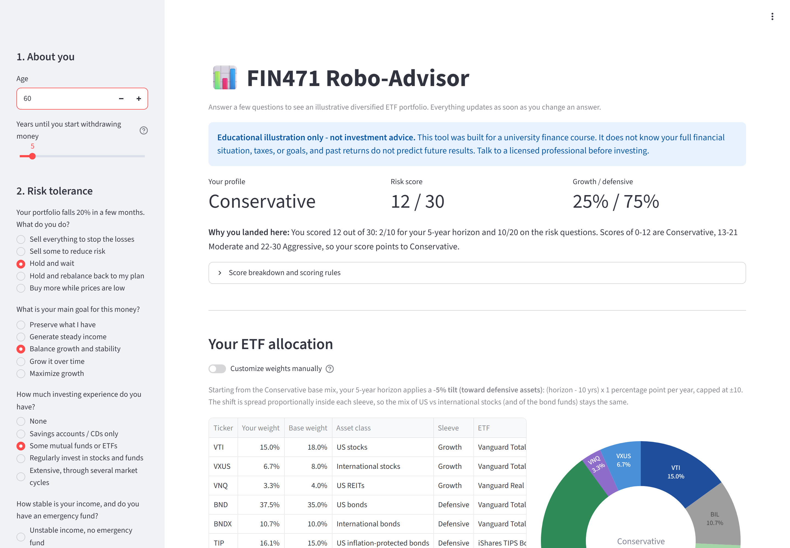
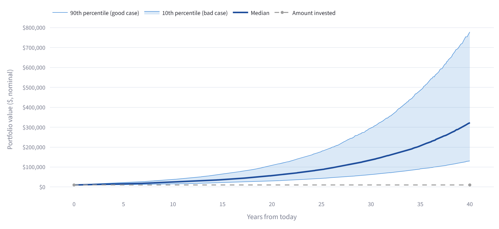
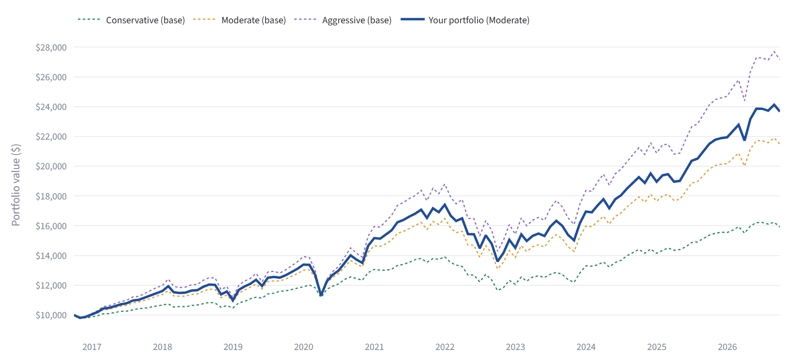
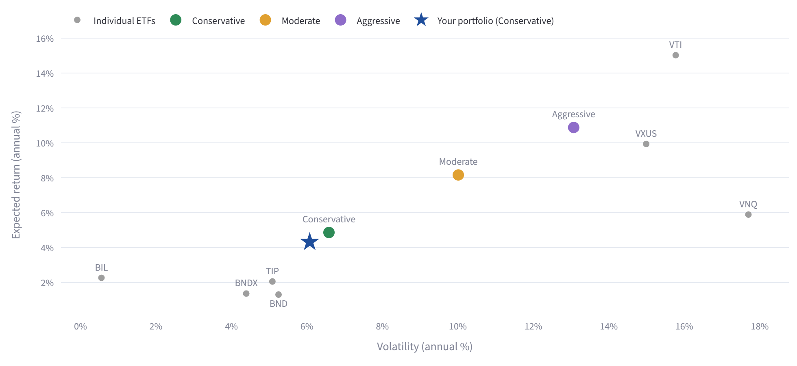
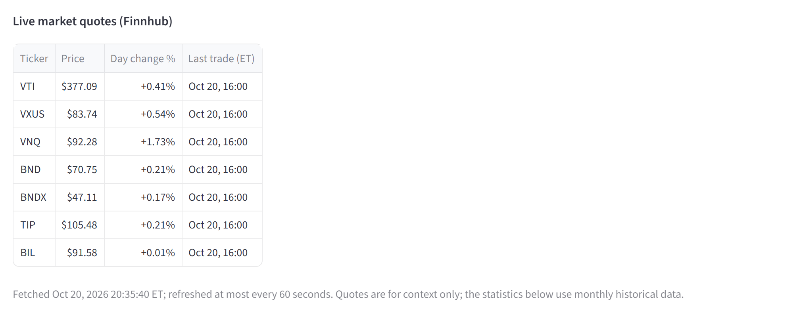

# FIN471 Robo-Advisor

**An AI-assisted robo-advisor and portfolio recommendation tool, built for FIN471 (Project 4).**

> ⚠️ **Educational illustration only, not investment advice.** This app was built for a university
> finance course. It does not know your full financial situation, taxes or goals, and past returns do
> not predict future results.



---

## Contents

1. [Purpose](#purpose)
2. [Features](#features)
3. [Screenshots](#screenshots)
4. [Install and run](#install-and-run)
5. [APIs and datasets](#apis-and-datasets)
6. [How recommendations are made](#how-recommendations-are-made)
7. [Financial concepts and formulas](#financial-concepts-and-formulas)
8. [Project structure](#project-structure)
9. [Testing](#testing)
10. [How the AI coding agent was used](#how-the-ai-coding-agent-was-used)
11. [Known limitations and incomplete features](#known-limitations-and-incomplete-features)

---

## Purpose

A simplified robo-advisor that:
1. Asks about your investment horizon and risk tolerance.
2. Classifies you as **Conservative**, **Moderate** or **Aggressive**, and shows your score and why.
3. Recommends a diversified allocation across 7 low-cost ETFs.
4. Estimates expected return, risk, Sharpe ratio and drawdown from real historical data, and projects
   your portfolio over your horizon with a Monte Carlo simulation.

Every input updates the results live. For example, a 25-year-old with a 40-year horizon gets a
Moderate portfolio tilted to **70% stocks / 30% bonds**. A 60-year-old with 5 years to go and the
same answers gets a Conservative portfolio at **25% / 75%**.

## Features

- **Risk questionnaire:**
  - Age, years until you start withdrawing, and 5 risk-tolerance questions.
  - Transparent 0–30 scoring with a points breakdown and a plain-English "why you landed here".
  - Safety caps for short horizons.
- **ETF allocation:**
  - Three base mixes of 7 ETFs (US and international stocks, REITs, US and international bonds, TIPS,
    T-bills).
  - A horizon tilt of up to ±10 percentage points, so the horizon shifts the allocation, not just the
    score.
  - A table and a donut chart.
- **Statistics from real data:**
  - Annualized expected return.
  - Volatility from the full covariance matrix.
  - Sharpe ratio using the FRED T-bill rate.
  - Max drawdown and backtest CAGR.
  - Per-ETF statistics.
- **Four charts:** allocation donut, historical growth of $10,000 (versus the three base profiles),
  Monte Carlo fan chart (10th/50th/90th percentiles), and a risk-vs-return scatter of the ETFs, the
  profiles and your portfolio.
- **Interactivity:**
  - Sliders and inputs update everything.
  - Lookback choice (5 years, 10 years or max).
  - Starting amount and monthly contribution.
  - A "Return assumptions" switch (historical, or a conservative adjustment).
- **Manual override:**
  - Type your own weights per ETF.
  - The portfolio is then labelled *Custom*, and every statistic and chart updates.
  - Negative weights are blocked.
  - A total other than 100% triggers a warning, plus *Normalize to 100%* and *Reset* buttons.
- **Live quotes:** price, daily % change and last-trade time from Finnhub for each ETF you hold.
  Quotes are cached for 60 seconds and timestamped.
- **Never crashes:**
  - Every data source has fallbacks: yfinance → Tiingo → last saved copy → bundled educational sample.
  - Missing or bad keys, no network and rate limits all produce clear messages.
  - Sidebar badges show which data source is in use.
- **In-app documentation:** a disclaimer, a *Methodology & Assumptions* section and a *Limitations*
  section.

## Screenshots

Generated with `scripts/take_screenshots.py` (headless Chromium via Playwright) from live data on
2026-10-20.

| 25-year-old, 40-year horizon | 60-year-old, 5-year horizon |
|---|---|
|  |  |

**Monte Carlo projection (age 25, $10,000, 40 years)**


**Historical backtest: growth of $10,000 (Oct 2016 – Sep 2026)**


**Risk vs. return (age 60: the star is the tilted Conservative portfolio)**


**Live quotes from Finnhub**


## Install and run

Requires **Python 3.12 or newer**, because the pinned numpy 2.5.4 needs it. A fresh clone of this
repository was tested on Windows 11 with **Python 3.12.10, 3.13.16 and 3.14.8**: every pinned package
installed, all tests passed and the app ran. Check your version with `python --version`. On an older
Python, `pip install` fails with "No matching distribution found for numpy==2.5.4".

**1. Get the code and create a virtual environment**

```bash
git clone https://github.com/cooperquandt70-creator/fin471-robo-advisor.git
cd fin471-robo-advisor
python -m venv .venv
```

Activate it:
- **Windows (PowerShell):** `.venv\Scripts\Activate.ps1`
- **macOS/Linux:** `source .venv/bin/activate`

If PowerShell refuses to run the activation script, skip activating and use
`.venv\Scripts\python.exe -m pip ...` and `.venv\Scripts\python.exe -m streamlit ...` in steps 2 and 4.

**2. Install the dependencies (exact versions are pinned)**

```bash
pip install -r requirements.txt
```

**3. Add your free API keys**

Copy the example file:
- **Windows:** `copy .env.example .env`
- **macOS/Linux:** `cp .env.example .env`

Open `.env` and paste in your keys. All three are free:

| Key | Sign up | Used for | Required? |
|---|---|---|---|
| `FINNHUB_API_KEY` | <https://finnhub.io/register> | Live quotes | Optional (the quote panel is hidden without it) |
| `FRED_API_KEY` | <https://fred.stlouisfed.org/docs/api/api_key.html> | 3-month T-bill rate | Optional (falls back to the bundled rate history) |
| `TIINGO_API_KEY` | <https://www.tiingo.com/account/api/token> | Backup price source | Optional (used only if yfinance fails) |

`.env` is listed in `.gitignore`, so your keys are never committed. The app runs with **no keys at
all**: prices come from yfinance, which needs no key, and the risk-free rate from the bundled sample.

**4. Run the app**

```bash
streamlit run app.py
```

> **First run only:** Streamlit prints *"Welcome to Streamlit! … Email:"* and waits. **Press Enter**
> to skip (leave it blank). Then open <http://localhost:8501> if your browser doesn't open by itself.

**Optional checks**

```bash
python scripts/check_apis.py              # tests each API with your keys (never prints them)
python scripts/check_apis.py --bad-key    # shows the error handling with fake keys
python -m pytest                          # 258 offline tests, about 15 seconds
```

To regenerate the screenshots: `pip install -r requirements-dev.txt`, then
`python -m playwright install chromium`, then `python scripts/take_screenshots.py`.

## APIs and datasets

All free tiers were checked against the official documentation on **2026-10-20** (Step 0 of
[docs/PLAN.md](docs/PLAN.md)). The findings were then confirmed with real keys using
`scripts/check_apis.py`.

| Source | What the app uses | Free-tier notes |
|---|---|---|
| **[Finnhub](https://finnhub.io/docs/api)** | `/quote`: current price, daily % change and last-trade time for each ETF in your allocation | Free key, 60 calls/minute. **Historical candles (`/stock/candle`) and every ETF endpoint (`/etf/profile`, `/etf/holdings`, `/etf/sector`, `/etf/country`) are premium-only.** They are flagged premium in Finnhub's official API spec, and a real free key got **HTTP 403** from them. So Finnhub is used for live quotes, and prices come from elsewhere. |
| **[yfinance](https://pypi.org/project/yfinance/)** (Yahoo Finance) | Main source of month-end, dividend-adjusted ETF prices, Jan 2013 onward | No key. An unofficial scraper: Yahoo's terms say "personal use only", and it can be rate-limited (`YFRateLimitError`), hence the fallbacks. |
| **[Tiingo](https://www.tiingo.com/documentation/end-of-day)** | Backup price source if yfinance fails | Free key: 50 requests/hour, 1,000/day, 500 symbols/month, 30+ years of end-of-day data. The license is "internal use only", fine for a class project. |
| **[FRED](https://fred.stlouisfed.org/series/DTB3)** (St. Louis Fed) | Series **DTB3**, the 3-month Treasury bill rate (monthly averages) | Free key. DTB3 is quoted on a discount basis, slightly below a bond-equivalent yield (DGS3MO). |
| **Bundled sample** (`data/snapshot_prices.csv`, `data/snapshot_dtb3.csv`) | Last-resort fallback when every live source fails | **Educational sample** (Jan 2013 – Sep 2026; may be stale). Regenerate with `python scripts/build_snapshot.py`. |
| [Alpha Vantage](https://www.alphavantage.co/documentation/) | *Evaluated, not used* | Only 25 requests/day; daily adjusted prices and full history are premium. |

**Cross-check of the two price sources:** over the same 10 years of monthly returns, yfinance and
Tiingo differ by at most **0.03 percentage points** in any month for VTI, and **0.23 points** for BND.
The small BND gap comes from how each source dates bond-fund dividends.

## How recommendations are made

### The ETF universe

| Ticker | Asset class | Sleeve | Role |
|---|---|---|---|
| VTI | US total stock market | Growth | Core growth |
| VXUS | International stocks | Growth | Global diversification |
| VNQ | US REITs | Growth | Real-asset diversifier |
| BND | US aggregate bonds | Defensive | Core ballast |
| BNDX | International bonds (USD-hedged) | Defensive | Bond diversification |
| TIP | US TIPS | Defensive | Inflation protection |
| BIL | 1–3 month T-bills | Defensive | Cash-like |

### Base allocations (%)

| Profile | VTI | VXUS | VNQ | BND | BNDX | TIP | BIL | Growth / defensive |
|---|---|---|---|---|---|---|---|---|
| Conservative | 18 | 8 | 4 | 35 | 10 | 15 | 10 | 30 / 70 |
| Moderate | 36 | 18 | 6 | 22 | 8 | 6 | 4 | 60 / 40 |
| Aggressive | 50 | 27 | 8 | 10 | 3 | 2 | 0 | 85 / 15 |

**Design choices:**
- US to international stocks is about 2:1, a deliberate home bias.
- REITs stay small.
- The Conservative mix holds more TIPS and cash for inflation protection and liquidity.
- Even the Aggressive mix keeps a small bond sleeve.

### Scoring

| Part | Points |
|---|---|
| **Horizon** (years until withdrawals start; defaults to 65 − age, minimum 1) | under 3 yrs = 0, 3–5 = 2, 6–10 = 5, 11–20 = 8, over 20 = 10 |
| **5 risk questions:** reaction to a 20% drop, goal, experience, income stability, gain/loss trade-off | 0 (most cautious) to 4 each, so 0–20 |
| **Total** | 0–30: **0–12 Conservative, 13–21 Moderate, 22–30 Aggressive** |
| **Safety caps** | horizon under 3 years → Conservative; 3–5 years → at most Moderate |

### Horizon tilt

Tilt = (horizon − 10 years) × 1 percentage point, capped at ±10. It moves weight between the growth
and defensive sleeves, and keeps the mix *inside* each sleeve unchanged.

**Why horizon counts twice.** The score sets the coarse bucket. The tilt then fine-tunes the mix
continuously inside it. Without the tilt, two people in the same bucket would get identical portfolios
regardless of horizon. The ±10-point cap means a tilt can never push a portfolio into another
profile's range.

## Financial concepts and formulas

All statistics use **monthly total returns** (dividend-adjusted prices) over the selected lookback
(default **10 years = 120 months**, Oct 2016 – Sep 2026). Only months where all 7 ETFs have data are
used. The math lives in [`finance.py`](finance.py) as small, commented functions.

| Concept | Formula |
|---|---|
| Monthly return | $r_t = P_t / P_{t-1} - 1$ |
| Expected annual return (per ETF) | $\mu_i = 12 \times \overline{r_i}$ (arithmetic) |
| Portfolio expected return | $\mu_p = w^\top \mu$ |
| Annualized covariance matrix | $\Sigma = 12 \times \text{Cov}(r)$ (sample covariance) |
| **Portfolio volatility** | $\sigma_p = \sqrt{w^\top \Sigma w} = \sqrt{\sum_i \sum_j w_i w_j \Sigma_{ij}}$ |
| Sharpe ratio | $(\mu_p - r_f) / \sigma_p$, where $r_f$ = average DTB3 over the lookback. Shown as **n/a** when $\sigma_p < 1\%$ (e.g. 100% T-bills), because dividing by almost zero is meaningless. |
| Backtest (monthly rebalancing) | $W_t = 10{,}000 \times \prod_{s \le t} (1 + w^\top r_s)$ |
| CAGR | $(W_T / W_0)^{1/\text{years}} - 1$ |
| Max drawdown | $\min_t \left( W_t / \max_{s \le t} W_s - 1 \right)$ |

### Why the covariance matrix matters: 0.1118, not 0.15

Take two assets with 20% and 10% volatility, correlation 0, and a 50/50 split:

$$\sigma_p = \sqrt{0.5^2 \times 0.20^2 + 0.5^2 \times 0.10^2} = \sqrt{0.0125} = 0.1118 = 11.18\%$$

A weighted average of the volatilities would give $0.5 \times 20\% + 0.5 \times 10\% = 15\%$. That
overstates risk, because it ignores the fact that the assets don't move together. The two only match
when the correlation is exactly 1. This exact case is a unit test, and the app shows the same
comparison for your portfolio. For the default 70/30 portfolio, the weighted average is 12.4% but
$\sqrt{w^\top \Sigma w}$ = 11.2%.

### Monte Carlo and volatility drag

The app simulates **5,000 paths** of monthly portfolio returns:
- Each month's return is drawn from a normal distribution with mean $\mu_p/12$ and volatility
  $\sigma_p/\sqrt{12}$.
- A fixed random seed (42) makes results reproducible.
- The chart shows the **10th, 50th (median) and 90th percentiles** over your horizon.
- For cash (BIL), the expected return is **today's** T-bill rate, the best forecast of next year's
  cash return. Volatility and correlations stay historical.

**Volatility drag.** The *median* path grows more slowly than the arithmetic expected return:

$$g_{\text{median}} \approx e^{\mu - \sigma^2/2} - 1$$

Compounding punishes volatility: a −20% year followed by a +20% year leaves you at 0.8 × 1.2 = 0.96,
a 4% loss, even though the average return was 0%. With μ = 8% and σ = 15%, the median grows at about
**7.1%** a year, not 8%. A unit test simulates 20,000 paths over 30 years and confirms the median
matches $e^{\mu - \sigma^2/2} - 1$ within 0.2 points. The app's caption reports the drag for your
portfolio.

### Return assumptions

| Setting | What it does |
|---|---|
| **Historical (default)** | Uses the lookback averages as they are. |
| **Conservative adjustment** | Subtracts **2.0 points** from equity ETFs (VTI, VXUS, VNQ) and **0.5 points** from bond ETFs (BND, BNDX, TIP); cash is unchanged. |

The adjustment exists because the last decade was unusually strong for US stocks. It changes the
expected return, Sharpe ratio, risk/return chart and Monte Carlo. It **never** changes the historical
backtest, CAGR or drawdown, which always show what actually happened.

### Lookback trade-offs

- **Monthly instead of daily data:** less noise and fewer stale-price effects in bond funds, but fewer
  data points.
- **10-year window:** recent and complete for all 7 ETFs (BNDX launched in mid-2013), but it excludes
  2008 and includes an unusually strong decade for US stocks plus the 2022 bond crash.
- The app offers 5 years and the maximum common history so you can see how sensitive the estimates
  are.

## Project structure

```
fin471-robo-advisor/
├── app.py                    # Streamlit UI only
├── finance.py                # all financial math (pure functions, no I/O)
├── profiles.py               # questionnaire, scoring, allocations, horizon tilt, weight checks
├── data.py                   # every API call + fallbacks + st.cache_data wrappers
├── data/
│   ├── snapshot_prices.csv   # bundled educational sample (fallback)
│   └── snapshot_dtb3.csv
├── scripts/
│   ├── check_apis.py         # live API smoke test (--bad-key mode too)
│   ├── build_snapshot.py     # regenerates the bundled sample
│   └── take_screenshots.py   # README screenshots via Playwright
├── tests/                    # 258 pytest tests (offline)
├── screenshots/
├── docs/
│   ├── PLAN.md               # approved plan, incl. Step 0 API verification
│   └── AI_USAGE.md           # full log of requests to the AI agent and its changes
├── requirements.txt          # pinned runtime dependencies
├── requirements-dev.txt      # + Playwright (screenshots only)
├── .env.example              # copy to .env and add your keys
└── .streamlit/config.toml    # turns off Streamlit usage statistics
```

## Testing

Run the whole suite. It takes about 15 seconds and is fully offline: every network call is mocked,
so results don't depend on Yahoo, FRED, Tiingo or Finnhub being up.

```bash
python -m pytest
```

**258 tests** in four files:

| File | What it checks |
|---|---|
| `tests/test_finance.py` | Every formula with hand-checkable numbers: the 0.1118-vs-0.15 case; MDD of −25% for the path 100 → 120 → 90 → 110; a Sharpe of 0.5; the Monte Carlo median growing at exp(μ − σ²/2) − 1; the conservative adjustment changing only forward-looking numbers. |
| `tests/test_profiles.py` | Scoring, cut-offs, safety caps, horizon tilt, weight validation and normalization, and the 25- vs 60-year-old example. |
| `tests/test_data.py` | The fallback chain, HTTP errors mapped to plain messages, rate-limit detection, and API keys never leaking into messages. |
| `tests/test_app.py` | Runs the real Streamlit app headlessly (`streamlit.testing.AppTest`) and checks what a user would see, including every robustness case below and the live-quote panel. |

### Robustness pass (milestone 8)

Each case has an automated test. The network cases were also run for real, outside pytest, against
the live APIs.

| # | Case | How it was tested | Result |
|---|---|---|---|
| 1 | **100% BIL** (cash, near-zero volatility) | AppTest + unit tests | Volatility is 0.56%. Sharpe shows **"n/a"** with the reason "volatility below 1%, so dividing by it would give a huge, meaningless number". No division by zero. For this window the unguarded value would have been −0.29, but with a 0.56% denominator it swings wildly (about −3.0 using today's T-bill rate). The Monte Carlo still runs. |
| 2a | **100% in one ETF** (VTI, VNQ, BND tested) | AppTest | All statistics and all 4 charts work. The diversification note says "none here: with everything in one ETF, portfolio volatility equals that ETF's volatility". 100% VTI: 15.0% expected return, 15.8% volatility, Sharpe 0.80, max drawdown −24.8%. |
| 2b | **All weights 0** | AppTest + unit test | Error: "All weights are zero. Give at least one ETF a positive weight." Statistics pause with a message. No Normalize button appears, since there's nothing to scale. No crash. |
| 3 | **1-year horizon** in the Monte Carlo | AppTest + unit test | 12-month projection. Labels read "1-year horizon" and "in 1 yr". 10th < median < 90th percentile. |
| 4a | **No `.env` file** | AppTest (keys removed) + **real run** of a copy with no `.env` | Prices load live from yfinance (no key needed). The T-bill rate falls back to the bundled sample, with the badge "No FRED_API_KEY in .env". All statistics shown. The quote panel shows "add FINNHUB_API_KEY". |
| 4b | **Bad API keys** | AppTest (mocked HTTP 400/401) + **real run** with invalid keys + `check_apis.py --bad-key` | Badges: "FRED rejected the request (HTTP 400): the API key is probably invalid", "Tiingo rejected the request (HTTP 401)…" and "Finnhub rejected the request (HTTP 401)…". Falls back to the saved copy or sample. Keys are never displayed. |
| 4c | **No network** | AppTest (mocked) + **real run** with all traffic sent to a dead proxy | Prices use the last saved copy, or the bundled educational sample when there is no saved copy (both verified for real). Badges say "Could not connect to FRED/Tiingo". All 4 charts are still shown. |
| 4d | **yfinance rate-limited** | AppTest + unit test with a mocked `YFRateLimitError` (it can't be triggered on demand) | Tiingo takes over: "Live prices from Tiingo, because yfinance was unavailable: Yahoo Finance rate limit reached". Without a Tiingo key, the bundled sample is used with the same explanation. |
| 5 | **$0 monthly contribution, $10,000,000 start** | AppTest + checked in the browser | The Monte Carlo axis switches to "$ millions" ($0M to $500M), and the "amount invested" line is flat. Metrics show "$92.1M / $208.1M / $485.8M". |
| 6 | **Finnhub quotes** (milestone 9) | AppTest with mocked quotes, a missing key and a rejected key | Shows only ETFs in the current allocation, with price, day change % and last trade in ET, plus a "Fetched …; refreshed at most every 60 seconds" timestamp. A missing key or a Finnhub failure shows a one-line message, and the rest of the app works. |

Also covered by tests:
- **Ages 64, 65, 66, 80 and 90:** the horizon is never 0 or negative (minimum 1 year).
- **Weights:** negative weights are blocked (inputs have a minimum of 0) and also rejected in code.
- **Data failures:** if every price source fails, the page shows an error but keeps your profile and
  allocation. If FRED is down, you can type a risk-free rate yourself.

## How the AI coding agent was used

This project was built with **Claude Code** (Anthropic's AI coding agent), working in small
milestones that I reviewed, tested and approved one at a time. The full request-by-request log is in
[docs/AI_USAGE.md](docs/AI_USAGE.md).

**Milestones:**
- **Planning and Step 0:** before any code, the agent checked each API's free tier against official
  sources: Finnhub's API spec (which flags candles and all ETF endpoints as premium), Tiingo's pricing
  page, the Alpha Vantage docs, yfinance on PyPI, and the FRED docs. It then asked me four clarifying
  questions. I chose:
  - the price source (yfinance plus fallbacks)
  - the lookback (10 years monthly)
  - the risk-free rate (the lookback average for Sharpe)
  - Finnhub's role (live quotes)

  I also requested plan revisions: show the exact covariance formula; add the strong-decade limitation;
  explain why horizon counts twice; use today's T-bill rate for cash in the Monte Carlo; commit the
  sample data with a regeneration script; and make the 0.1118 test required.
- **M0, scaffold:** `.gitignore`, `.env.example`, a virtual environment, and pinned `requirements.txt`.
- **M1, `finance.py`:** the core formulas and 17 hand-checkable tests, including the required
  0.1118-vs-0.15 test.
- **M2, `profiles.py`:** questionnaire scoring, cut-offs, safety caps and the horizon tilt, with tests
  for the 25- vs 60-year-old example.
- **M3, `data.py`:** the fallback chain, FRED, Finnhub, `check_apis.py`, `build_snapshot.py`, and
  offline tests. Live checks confirmed the Finnhub 403s, and yfinance agreed with Tiingo.
- **M4, first app:** questionnaire, score explanation, allocation table and donut, and the first
  `AppTest` smoke tests.
- **Between M4 and M5:** relabelled the horizon input to "Years until you start withdrawing money",
  added the retirement-spending limitation, and tested ages 64–80.
- **M5, statistics:** return, covariance volatility, Sharpe, drawdown, the $10,000 backtest, the
  lookback selector, and data-source badges. A cross-check confirmed $\sqrt{w^\top\Sigma w}$ equals
  the standard deviation of the backtest's own returns × √12.
- **M6:** Monte Carlo (fixed seed, 10/50/90 bands, starting amount, nominal-dollars note, a test that
  the median grows at the geometric return), the risk/return scatter, and the Playwright screenshot
  script.
- **M7:** manual weight override (Custom label, validation, Normalize and Reset) and the conservative
  return adjustment.
- **M8:** per-ETF number inputs replaced the data editor, plus the robustness pass in the
  [Testing](#testing) section.
- **M9:** the Finnhub live quote panel, full in-app Methodology and Limitations, this README, and
  regenerated screenshots.

**Problems found and fixed along the way:**
- **Chart crash:** the donut chart crashed on Plotly 7's stricter hover-data rules. The first
  `AppTest` caught it.
- **Hidden weight columns:** on narrow screens they were cut off, so the table columns were
  reordered.
- **Screenshot script bugs:** it captured the bottom of the page because Streamlit scrolls an inner
  container, and the "Your portfolio" star covered a chart label.
- **Stale server:** a long-running dev server kept an old copy of a module in memory and showed an
  `AttributeError`. Restarting the server fixed it; the code was fine.
- **Misleading offline messages:** with no network, the badge said "possibly rate-limited" and
  yfinance printed "possibly delisted". The messages were rewritten and yfinance's logging silenced.
- **Cut-off dollar amounts:** "$92,117,…" read as $92 thousand in narrow columns, so large amounts
  are now shown as "$92.1M".
- **Smaller fixes:** "in 1 yrs" now reads "in 1 yr", a nested-parentheses label was cleaned up, and
  the quote screenshot's crop was widened.
- **A wrong test:** one new test had the wrong Unix timestamp; the app's time zone conversion was
  correct.
- **Security:** the agent noticed an untracked `.env.txt` copy holding my real keys and added a
  `.env.*` ignore rule. Keys never appear in error messages, and Finnhub and Tiingo keys are sent in
  request headers rather than URLs.

> ✏️ **TODO (student): replace this block with a paragraph in your own words before submitting.**
> Suggested points (delete this line): what you decided yourself versus what the agent proposed, how
> you checked its work, and what you learned or would do differently.

## Known limitations and incomplete features

**Limitations** (also shown in the app):
- **Simplified horizon:** the app uses the years until withdrawals *start*. Retirement spending
  continues for many years after that, so the real horizon is longer.
- **An unusual decade:** the 10-year lookback includes an unusually strong period for US stocks and
  the 2022 bond drawdown. Expected returns are illustrative, not forecasts.
- **Nominal dollars:** projections are not adjusted for inflation. At 2.5% inflation, $1 in 30 years
  buys about 48 cents of today's goods.
- **Normal returns:** the Monte Carlo assumes normal, independent monthly returns. Real markets have
  fatter tails, and future averages may differ from the past.
- **No costs or taxes:** expense ratios, trading costs, taxes and account types are ignored.
- **Not a suitability assessment:** five questions and a horizon are far less than a real advisor
  would consider.
- **Data caveats:** yfinance is unofficial; the bundled sample may be stale; DTB3 is on a discount
  basis; live quotes are context only and not used in any calculation.

**Incomplete or not implemented:**
- No inflation-adjusted ("real dollars") view of the projection, and no withdrawal-phase
  (decumulation) modeling.
- Finnhub is used only for quotes. Its historical and ETF-profile data are premium, so ETF
  descriptions are hard-coded.
- The questionnaire's point values and cut-offs are reasoned judgment calls, not calibrated against
  real investor data.
- A real yfinance rate limit can't be triggered on demand, so that path is tested with mocks only.
- Developed on Windows 11 with Python 3.12, and fresh-clone tested there on Python 3.12, 3.13 and 3.14.
  The macOS/Linux commands above are standard but untested.

---

*Educational illustration only, not investment advice.*
